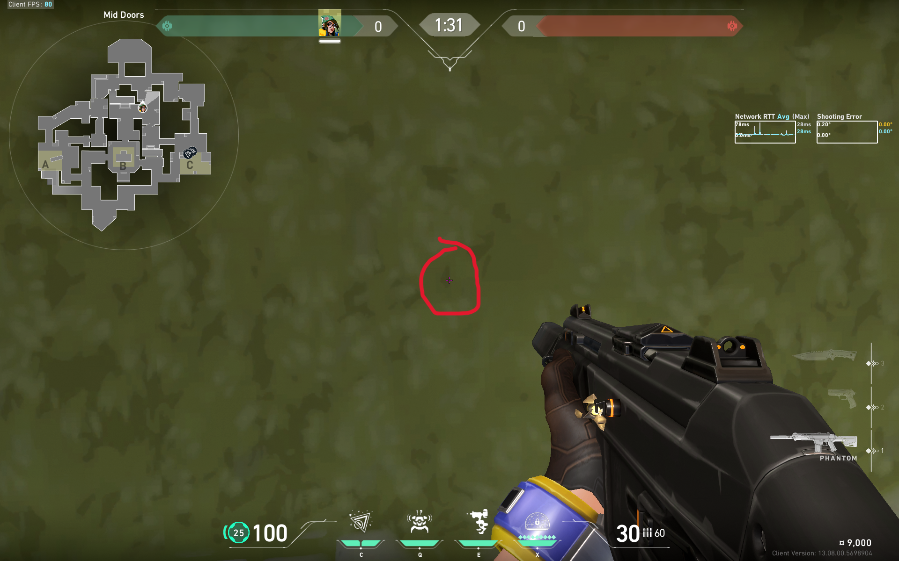
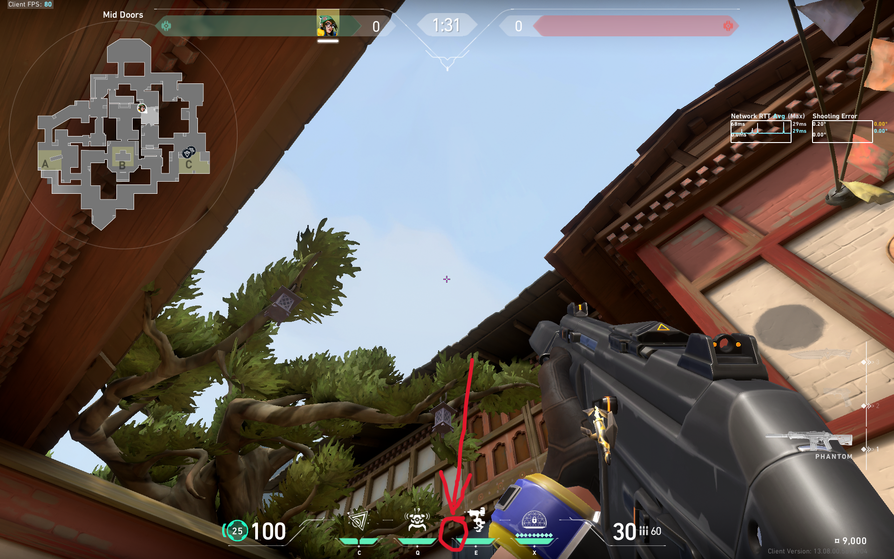

# Haven, Site C, lineup #2

## _Post-Plant_

> _Style:_ `Peak-jump` or `Jump-throw`

> _Comment:_ It's possible to cover the area behind the boxes with jump-throw, or ahead the boxes with peak-jump.

### Visual Guide

  
  

